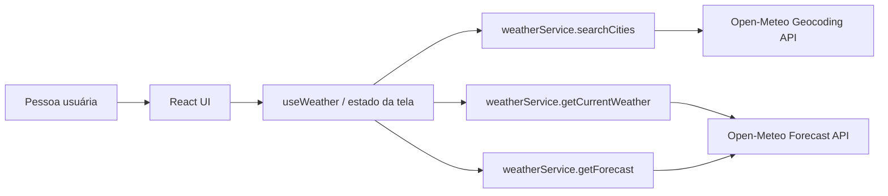
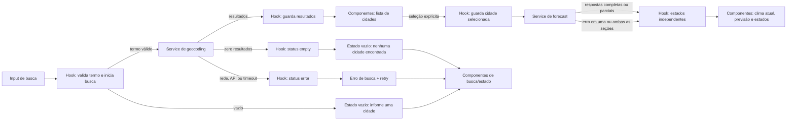

# Plano Técnico — Weather App

Este plano deriva de `specs/weather-app-spec.md`, que é a fonte da verdade para
escopo e comportamento. Ele define arquitetura e contratos para o MVP; não
implementa a aplicação. Os requisitos de conteúdo mínimo e os critérios de
produção ainda sujeitos a validação permanecem pendentes conforme a spec.

## Architecture

Aplicação cliente em camadas, sem backend próprio. `App` compõe a tela; as
dependências seguem da apresentação para a orquestração e desta para os
serviços. Tipos e funções puras são compartilhados sem depender da UI:



- **Apresentação (`components/`):** componentes React recebem dados/estados e
  expõem ações acessíveis; não chamam APIs nem decidem política de retry.
  (RF-01 a RF-06, RNF-01, RNF-04)
- **Orquestração (`hooks/`):** `useWeather` coordena busca e seleção, mantém
  estado da tela e dispara operações independentes de clima atual e previsão.
  (RF-06, AC-06.2–AC-06.4)
- **Acesso a dados (`services/`):** funções isolam `fetch`, parâmetros,
  timeout, validação e normalização de DTOs Open-Meteo para tipos de domínio.
  Não conhecem componentes ou estado React. (RNF-03, RNF-07)
- **Funções puras (`lib/`):** conversão de temperatura, formatação e
  interpretação de códigos meteorológicos sem efeitos colaterais.
- **Contratos (`types/`):** tipos compartilhados sem lógica ou dependências de
  runtime.

Direção permitida: `components` → `hooks` → `services`; `hooks`, `services` e
`components` podem consumir `types`/`lib` conforme necessário. `lib` e `types`
não importam React, serviços nem componentes. Essa direção mantém a interface
substituível e permite testar cada camada isoladamente.

## Tech Stack

- **TypeScript strict, React 19 e Vite:** stack existente, adequada a uma SPA
  pequena e sem necessidade de backend ou roteamento adicional.
- **Tailwind CSS:** sistema de estilo já adotado no projeto; a interface deve
  preservar responsividade a partir de 320 px. (RF-05, RNF-01)
- **Fetch nativo:** suficiente para as duas APIs HTTP; não adicionar cliente de
  rede ou biblioteca de estado para este escopo.
- **Vitest, Testing Library e Playwright:** stack já instalada para testes
  unitários/de componentes e fluxos no navegador.
- **Open-Meteo:** geocodificação e previsão sem API key, conforme decisão da
  spec. Cobertura, limites e licença ainda devem ser confirmados antes do
  lançamento. (RNF-07)

## Project Structure

Manter a estrutura atual e separar responsabilidades dentro das pastas já
existentes, sem criar camadas ou abstrações adicionais:

```text
src/
  App.tsx                       # compõe a tela e conecta componentes ao hook
  main.tsx                      # inicializa React e estilos globais
  components/                   # apresentação e interação acessível
    SearchBar.tsx               # submissão da busca e seleção de localidade
    CurrentWeather.tsx          # apresentação do clima atual
    ForecastList.tsx            # composição da previsão diária
    ForecastCard.tsx            # apresentação de um dia
    UnitToggle.tsx               # escolha da unidade de temperatura
    states/                     # loading, erro e vazio reutilizáveis
  hooks/
    useWeather.ts               # estado da tela e coordenação dos serviços
  services/
    weatherService.ts           # Open-Meteo, validação e normalização
  lib/
    temperature.ts              # conversão/formatação de temperatura
    weatherCodes.ts              # códigos WMO para rótulos pt-BR
    format.ts                    # formatação de datas e valores
  types/
    weather.ts                   # City, CurrentWeather, ForecastDay, etc.
  styles/
    index.css                    # estilos globais e diretivas Tailwind
```

Os componentes filhos recebem dados, estado e callbacks necessários pelo
componente de composição; o hook é dono do estado compartilhado da consulta.
O serviço é a única camada que conhece URLs e formatos brutos da API. Isso
evita duplicar parsing e mantém a UI independente do provedor.

Essa divisão dá um alvo de teste natural por responsabilidade: testar `lib`
como funções puras; testar `weatherService` com `fetch` controlado; testar
`useWeather` simulando os métodos do serviço, incluindo falhas e retries
independentes; e testar componentes por suas interações/estados visíveis. Os
testes E2E validam o fluxo integrado, sem substituir os testes focados. Não é
necessário introduzir cliente HTTP, camada de repositório, Context global ou
biblioteca de estado para permitir esses testes.

Os testes permanecem fora de `src/`, agrupados por escopo:

| Caminho | Responsabilidade |
| --- | --- |
| `tests/unit/` | Testes de serviços, conversões, códigos, hook e interações de componentes. |
| `tests/e2e/` | Fluxos completos de busca, seleção, consulta, unidade e retry. |

## Data Model

### Integração atual da UI

`App.tsx` usa `useWeather` e renderiza o status agregado da consulta:
`idle`, `loading`, `empty`, `error` ou `success`. A busca chama o hook e o botão
de erro chama `retry`. A unidade permanece no estado da UI e não dispara rede.
O mock e o seletor manual de estados foram removidos da tela; o mock permanece
como fixture de testes, que interceptam a rede ou simulam os serviços.
O teste `tests/e2e/layout.spec.ts` verifica a integração em 320, 640, 1024 e
1440 px, navegação por teclado e contraste de texto de pelo menos 4,5:1.
Controles têm altura mínima de 44 px; o link de salto leva ao conteúdo principal.
Temperaturas permanecem em Celsius e são convertidas apenas na renderização.
Métricas fora do contrato não são exibidas. Essa etapa não substitui a
integração com seleção explícita e estados independentes prevista em T-45/T-30.

Contratos de domínio propostos. Valores de temperatura recebidos em Celsius;
Fahrenheit é uma representação de UI, não uma segunda fonte de dados.

```ts
type Unit = 'celsius' | 'fahrenheit';

interface City {
  id?: number; // Identificador da localidade retornado pelo Geocoding API.
  name: string; // Nome da cidade retornado pelo Geocoding API.
  latitude: number; // Latitude usada para consultar a previsão.
  longitude: number; // Longitude usada para consultar a previsão.
  region?: string; // Região/estado, normalizado de admin1 quando disponível.
  country?: string; // País retornado pelo Geocoding API.
  countryCode?: string; // Código do país, normalizado de country_code.
  timezone?: string; // Fuso IANA retornado pelo Geocoding API, quando disponível.
}

interface CurrentWeather {
  temperatureCelsius: number; // current.temperature_2m solicitado em Celsius.
  weatherCode: number; // current.weather_code, código WMO da condição atual.
  observedAt?: string; // current.time local retornado pela Forecast API.
}

interface ForecastDay {
  date: string; // daily.time no formato YYYY-MM-DD do fuso da cidade.
  minimumCelsius: number; // daily.temperature_2m_min solicitado em Celsius.
  maximumCelsius: number; // daily.temperature_2m_max solicitado em Celsius.
  weatherCode?: number; // daily.weather_code WMO, se válido e disponível.
}

interface WeatherData {
  city: City; // Localidade selecionada à qual os dados pertencem.
  current: CurrentWeather; // Condições atuais normalizadas da Forecast API.
  forecast: ForecastDay[]; // Dias locais normalizados da Forecast API.
}

interface WeatherService {
  searchCities(query: string, signal?: AbortSignal): Promise<City[]>;
  getCurrentWeather(city: City, signal?: AbortSignal): Promise<CurrentWeather>;
  getForecast(city: City, signal?: AbortSignal): Promise<ForecastDay[]>;
}
```

Clima atual só é válido quando temperatura e código/condição podem ser
interpretados. Previsão só é válida quando contém exatamente cinco datas locais
consecutivas, começando hoje, com mínima e máxima numéricas para cada dia.
Campos opcionais inválidos são omitidos. Campos complementares fora desses
contratos não entram no MVP até aprovação explícita. (AC-02.1–AC-02.4,
AC-03.1–AC-03.5)

`City.id` usa o identificador fornecido pelo serviço de geocodificação; latitude
e longitude identificam o local para a consulta. Região, país e fuso são
metadados opcionais e só são exibidos/usados quando fornecidos. Datas da
previsão devem permanecer datas civis locais, sem convertê-las para o fuso do
navegador.

## Data Flow



1. A pessoa submete o termo. O cliente remove espaços externos; vazio não chama
   o serviço. Acentos e pontuação interna são preservados. (AC-01.1–AC-01.2)
2. O serviço de geocodificação retorna zero ou mais cidades. A UI distingue
   lista vazia de falha e não seleciona um resultado implicitamente.
   (AC-01.3–AC-01.6)
3. Alterar o termo invalida resultados anteriores imediatamente. Respostas
   assíncronas antigas não podem substituir os resultados do termo atual; usar
   cancelamento quando disponível ou ignorar respostas obsoletas por identidade
   da solicitação. (AC-01.8)
4. A seleção explícita de uma cidade inicia em paralelo as operações de clima
   atual e previsão, cada uma com seu próprio estado. (AC-01.7, AC-06.2)
5. Cada resposta é validada e normalizada no serviço. Dados inválidos falham
   apenas a respectiva seção; sucesso de uma seção não depende da outra.
   (AC-02.4, AC-03.4, AC-06.2)
6. A UI apresenta temperaturas na unidade ativa. Alternar a unidade converte os
   valores válidos já carregados, sem novas consultas ou alteração de cidade,
   datas ou disponibilidade. (AC-04.1–AC-04.5)
7. Retry de seção chama somente a operação que falhou e preserva os dados da
   outra seção. (AC-06.3–AC-06.4)

## External APIs

Base URLs HTTPS do Open-Meteo; nenhuma API key é necessária no MVP.

### Geocoding

- **URL:** `https://geocoding-api.open-meteo.com/v1/search`
- **Parâmetros:** `name` é o termo sem espaços externos (preservar acentos e
  pontuação); `count` limita resultados; `language=pt` pede nomes/localizações
  em português quando disponíveis; `format=json` seleciona JSON.
- **Exemplo de requisição:**
  `GET https://geocoding-api.open-meteo.com/v1/search?name=Sao%20Paulo&count=10&language=pt&format=json`
- **Resposta resumida (esquemática):**

  ```json
  {
    "results": [
      {
        "id": 123456,
        "name": "Example City",
        "latitude": -23.55,
        "longitude": -46.63,
        "country_code": "BR",
        "country": "Brazil",
        "admin1": "Example State",
        "timezone": "America/Sao_Paulo"
      }
    ]
  }
  ```

- **Mapeamento para `City`:** `id` → `id`; `name` → `name`; `latitude` e
  `longitude` mantêm o mesmo nome; `admin1` → `region`; `country` → `country`;
  `country_code` → `countryCode`; `timezone` → `timezone`. Propriedades de
  localização nulas, ausentes ou inválidas são omitidas; nome e coordenadas são
  obrigatórios e devem ser válidos. `results` ausente ou nulo equivale a busca
  sem resultados. Não selecionar automaticamente um resultado. Resposta sem
  resultados é estado vazio; falha HTTP, timeout ou JSON inválido é erro
  recuperável.

### Forecast

- **URL:** `https://api.open-meteo.com/v1/forecast`
- **Parâmetros comuns:** `latitude` e `longitude` vêm da cidade selecionada;
  `temperature_unit=celsius` mantém uma representação canônica para converter
  na UI; `timezone=auto` usa o fuso das coordenadas.
- **Consulta de clima atual:** incluir
  `current=temperature_2m,weather_code`.
- **Consulta de previsão:** incluir
  `daily=temperature_2m_min,temperature_2m_max,weather_code` e
  `forecast_days=5`. Os cinco dias são lidos no calendário local indicado pela
  resposta.
- **Exemplos de requisição:**

  ```text
  GET https://api.open-meteo.com/v1/forecast?latitude=-23.55&longitude=-46.63&current=temperature_2m,weather_code&temperature_unit=celsius&timezone=auto
  GET https://api.open-meteo.com/v1/forecast?latitude=-23.55&longitude=-46.63&daily=temperature_2m_min,temperature_2m_max,weather_code&temperature_unit=celsius&timezone=auto&forecast_days=5
  ```

- **Resposta resumida de clima atual (esquemática):**

  ```json
  {
    "timezone": "America/Sao_Paulo",
    "current_units": { "temperature_2m": "°C" },
    "current": {
      "time": "2026-11-05T12:00",
      "temperature_2m": 22.4,
      "weather_code": 2
    }
  }
  ```

- **Mapeamento para `CurrentWeather`:** `current.temperature_2m` →
  `temperatureCelsius`; `current.weather_code` → `weatherCode`; `current.time`
  → `observedAt`. Temperatura e código são obrigatórios e devem ser válidos;
  horário nulo, ausente ou inválido é omitido.
- **Resposta resumida de previsão (esquemática):** o exemplo mostra dois dos
  cinco itens; a resposta usada pela aplicação deve conter os cinco.

  ```json
  {
    "timezone": "America/Sao_Paulo",
    "daily_units": {
      "temperature_2m_min": "°C",
      "temperature_2m_max": "°C"
    },
    "daily": {
      "time": ["2026-11-05", "2026-11-06"],
      "temperature_2m_min": [17.1, 18.0],
      "temperature_2m_max": [25.2, 26.4],
      "weather_code": [2, 3]
    }
  }
  ```

- **Mapeamento para `ForecastDay[]`:** as arrays `daily.time`,
  `daily.temperature_2m_min`, `daily.temperature_2m_max` e `daily.weather_code`
  são alinhadas pelo índice. Cada índice gera um item: `time` → `date`, mínima
  → `minimumCelsius`, máxima → `maximumCelsius`, código WMO → `weatherCode`.
  Se o array/código estiver ausente, nulo ou inválido, omitir apenas
  `weatherCode`; ausência ou invalidade de data, mínima ou máxima invalida a
  seção. Na apresentação, valores não finitos/ausentes recebem `—`, sem gerar
  valor meteorológico presumido. Validar exatamente cinco datas locais
  consecutivas, começando hoje.
- **Operação combinada implementada:** `getWeather(city)` consulta `current` e
  `daily` em uma única requisição, conforme solicitado para esta etapa. Retorna
  os contratos em Celsius, valida cinco datas consecutivas e rejeita o agregado
  se uma seção estiver incompleta. Quando há horário local válido, a primeira
  data da previsão deve coincidir com sua data civil. Horário e códigos diários
  inválidos são omitidos. Essa operação não atende ao retry independente:
  as operações separadas de T-07/T-08 continuam necessárias para a integração final.
- **Independência das seções:** fazer chamadas separadas ao mesmo endpoint,
  uma com `current` e outra com `daily`. Assim, falha e retry permanecem
  independentes conforme AC-06.2–AC-06.4. Montar `WeatherData` com a `City`
  selecionada e as duas respostas normalizadas quando disponíveis; a UI ainda
  mantém os estados de cada seção separados para apresentar sucesso parcial.
- **Unidade:** `Unit` representa a preferência de exibição (`celsius` ou
  `fahrenheit`), não um campo da resposta. Converter os valores canônicos em
  Celsius na apresentação; não converter `weatherCode` nem datas.

- Converter os códigos WMO reconhecidos para condições em pt-BR. Código ausente
  ou desconhecido não deve produzir condição inventada; se a condição atual
  obrigatória não puder ser apresentada, a seção atual é indisponível.

Os campos/parâmetros exatos devem ser conferidos com a versão vigente da API na
implementação. Timeout e política de repetição automática não são definidos
neste plano: a spec exige erro recuperável e retry manual, mas deixa duração e
política operacional para decisão dos stakeholders (RNF-03).

## State Management

### Etapa atual do hook

Conforme solicitado para esta etapa, `useWeather` expõe um status agregado,
`data`, `cities`, `error` (mensagem ou `null`), `query`, `search`, `selectCity`
e `retry`. `search` remove espaços externos e, havendo cidades, carrega
automaticamente o clima da primeira por `getWeather`, mantendo todas as opções.
Busca sem resultados vira `empty`; termo vazio limpa o estado para `idle` sem rede.
`selectCity` permite trocar a cidade. `retry` repete a última chamada de serviço:
busca após falha de geocodificação ou resultado vazio, clima após seleção ou
falha meteorológica. Uma busca nova substitui a operação anterior de retry.
Respostas superadas ou recebidas após desmontagem são ignoradas por identidade;
os serviços continuam responsáveis pelo timeout. A unidade permanece na UI.

Essa seleção automática foi solicitada para o hook atual, mas difere de AC-01.3
e AC-01.7. O status agregado também não oferece estados/retries independentes.
A integração final com seleção explícita e isolamento de seções continua
pendente em T-16/T-17; o App consome o hook agregado nesta etapa.

`useWeather` é dono do estado da consulta da tela: termo atual, resultados da
busca, cidade selecionada, estados do clima atual e da previsão e unidade
ativa. Os componentes recebem esses valores e callbacks, sem duplicar dados
meteorológicos em estado local. Estado puramente visual, como foco de um
controle, pode permanecer no componente. Usar estado local React; não adicionar
Redux, Context global ou cache persistente. A unidade inicia em `celsius` e
não é persistida entre sessões. (AC-04.1, RNF-06)

Busca, clima atual e previsão mantêm estados assíncronos independentes:

```ts
type AsyncState<T> =
  | { status: 'idle' }
  | { status: 'loading' }
  | { status: 'success'; data: T }
  | { status: 'empty' }
  | { status: 'error'; error: WeatherError };

interface WeatherError {
  kind: 'network' | 'api' | 'timeout' | 'invalid-response';
  message: string;
  statusCode?: number;
}
```

`idle` indica operação não iniciada; `loading`, requisição em andamento;
`success`, dados validados; `empty`, busca bem-sucedida sem cidades; e `error`,
falha recuperável. `empty` só é usado na busca, nunca no clima atual ou na
previsão. Ao iniciar consulta para outra cidade, remover os dados meteorológicos
anteriores para não apresentá-los como atuais. Ao editar o termo, invalidar os
resultados da busca anterior. (AC-01.8, AC-06.1)

Armazenar temperaturas somente em Celsius, conforme o contrato dos serviços.
Na renderização, uma função pura de `lib/temperature.ts` deriva o valor exibido:
mantém Celsius ou calcula Fahrenheit como `C × 9/5 + 32`, e formata com o
símbolo da unidade ativa. Alterar a unidade modifica somente `unit`: não altera
os dados nem dispara request. Aplicar a mesma regra à temperatura atual e às
mínimas/máximas; datas e códigos meteorológicos não são convertidos. Não manter
valores convertidos em estado, evitando conversões acumuladas e refetches.
(AC-04.2–AC-04.5)

## Error Handling

O helper compartilhado `fetchWithTimeout` usa um `AbortController` por requisição
com limite de 10 segundos nesta etapa de desenvolvimento. `AbortError` vira
`WeatherServiceError` com “A requisição demorou demais.”; falha de rede vira
“Falha de rede.”. O timer é limpo no `finally`, inclusive em sucesso e falha.
Esse limite não substitui a aprovação operacional pendente em RNF-03.

- **Rede:** falha de conexão, DNS ou indisponibilidade de rede vira `error` com
  `kind: 'network'`; mostrar mensagem pt-BR e retry da operação correspondente.
- **API:** resposta HTTP não-2xx, incluindo limite/erro do provedor, vira
  `error` com `kind: 'api'` e `statusCode` quando disponível. Não expor na UI
  detalhes técnicos ou o corpo bruto da resposta.
- **Timeout:** encerrar somente a operação que excedeu o limite, classificar
  como `kind: 'timeout'` e oferecer retry manual. A duração permanece pendente
  de decisão dos stakeholders (RNF-03, AC-06.4).
- **Resposta inválida:** JSON ilegível, formato inesperado ou campo obrigatório
  não interpretável vira `error` com `kind: 'invalid-response'`; nunca tratar
  erro de parsing/validação como busca vazia.
- **Resposta parcial:** omitir complementos ausentes/inválidos. No clima atual,
  temperatura e condição são obrigatórias; na previsão, as cinco datas locais
  consecutivas e suas mínimas/máximas são obrigatórias. Falta de campo
  obrigatório invalida somente sua seção, sem fabricar dados ou exibir previsão
  incompleta como completa. (AC-02.3–AC-02.4, AC-03.3–AC-03.4)
- **Vazio:** busca válida sem cidades usa `empty`, informa ausência de
  resultados e permite editar o termo; é distinto de erro da API. (AC-01.5–AC-01.6)
- **Independência e retry:** manter estados próprios para busca, clima atual e
  previsão. Erro ou retry de uma seção não apaga nem refaz a outra. (AC-06.2–AC-06.4)
- **Requisições obsoletas:** cancelar ou ignorar resposta ligada a termo/cidade
  superados para que não sobrescreva o estado atual. (AC-01.8)

Em qualquer operação ativa, indicar `loading` e não apresentar dados antigos
como se fossem uma resposta nova (AC-06.1). Mensagens devem ser acionáveis e
acessíveis; detalhes técnicos ficam no serviço/hook.

O valor numérico do timeout deve ser uma configuração única por operação,
ajustável nos testes e substituível quando stakeholders definirem o valor de
produção; este plano não recomenda uma duração não aprovada.

## Testing Strategy

- **Vitest — funções puras:** cobrir conversão Celsius/Fahrenheit, identidade
  Celsius, formatação/símbolo, códigos WMO e validação de cinco datas locais.
  Confirmar que alternar unidade sempre deriva do valor Celsius original.
- **Vitest — services:** mockar `fetch`; verificar URLs/parâmetros, mapeamento
  de respostas para os tipos de domínio, resultados vazios e respostas válidas.
  Cobrir rejeição de rede, HTTP não-2xx, timeout, JSON inválido e campos
  obrigatórios ausentes/inconsistentes, sem chamadas reais à Open-Meteo.
- **Vitest + Testing Library — componentes:** verificar apresentação e ações
  nos estados `loading`, `error`, `empty` e `success`; incluir busca, seleção,
  retry acessível e alternância de unidade sem disparar nova consulta.
- **Vitest — hook/orquestração:** provar independência entre clima atual e
  previsão, retry isolado, descarte de resposta obsoleta e timeout de uma
  operação sem cancelar a outra.
- **Playwright — E2E:** percorrer busca, escolha explícita de cidade, exibição
  de clima e previsão, alternância Celsius/Fahrenheit sem request adicional e
  retry de uma seção mantendo a outra. Interceptar as APIs para respostas
  determinísticas e falhas controladas.
- **Playwright — mobile:** executar o fluxo principal em viewport de 320 px;
  verificar que busca, seleção, dados e retry continuam acessíveis, sem
  rolagem horizontal, e validar interação básica por teclado. (AC-01.1–AC-06.5)
- **Execução:** mudanças de código devem passar `pnpm lint`, `pnpm build` e
  `pnpm test`; mudanças de fluxo E2E também executam `pnpm test:e2e`.

## Risks & Trade-offs

| Decisão | Alternativa considerada | Trade-off |
| --- | --- | --- |
| Estado local no hook da tela | Redux, Context global ou store externa | Estado simples e próximo do fluxo reduz dependências; uma store global só compensaria com múltiplas telas/consumidores coordenados. |
| Chamadas Forecast separadas para `current` e `daily` | Uma única resposta contendo ambos | Duas chamadas aumentam tráfego, mas isolam falhas e retries como exige a spec; a chamada combinada reduziria requests, porém acoplaria disponibilidade das seções. |
| Celsius como valor canônico e conversão na renderização | Solicitar novamente à API ao mudar unidade ou armazenar as duas unidades | Evita request e valores duplicados; exige conversão/formatador puro testado. |
| `fetch` nativo | Adicionar cliente HTTP | Menos dependências para duas APIs simples; parsing, timeout e erros ficam explicitamente sob responsabilidade do serviço. |
| Validação estrita dos campos mínimos | Mostrar qualquer subconjunto de dados disponível | Evita declarar completa uma resposta que não atende à spec; pode indisponibilizar uma seção mesmo com alguns campos úteis. Opcionais continuam omitidos. |
| Sem persistência de unidade/cidade | `localStorage` ou backend | Reduz estado persistente e risco de privacidade; a preferência volta a Celsius em nova sessão. |
| E2E com APIs interceptadas | Depender da Open-Meteo real nos testes | Testes determinísticos e sem rede; não medem disponibilidade real, que deve ser verificada operacionalmente. |
| Conteúdo mínimo ainda provisório | Tratar os campos como aprovados | Permite prototipagem, mas aprovação de stakeholders segue necessária antes do aceite de produção. |
| Timeout, desempenho, suporte e acessibilidade | Fixar metas sem decisão de produto | Configuração flexível evita inventar compromissos; aceite de produção fica bloqueado até definição. |
| Open-Meteo como provedor inicial | Outro provedor ou backend proxy | Sem API key e integração direta simplificam o MVP; há dependência de cobertura, limites, disponibilidade e licença do provedor. |
| Seleção explícita e dados de região/país quando disponíveis | Selecionar automaticamente o primeiro resultado | Evita escolha silenciosa da cidade errada; metadados ausentes ainda podem dificultar a distinção de homônimos. |

Bloqueios para aceite de produção permanecem: aprovação do conteúdo mínimo,
metas de desempenho e timeout, matriz de suporte/acessibilidade e confirmação
de cobertura/limites/licença do provedor. Nenhum deles deve ser mascarado por
valores padrão apresentados como decisões de produto.